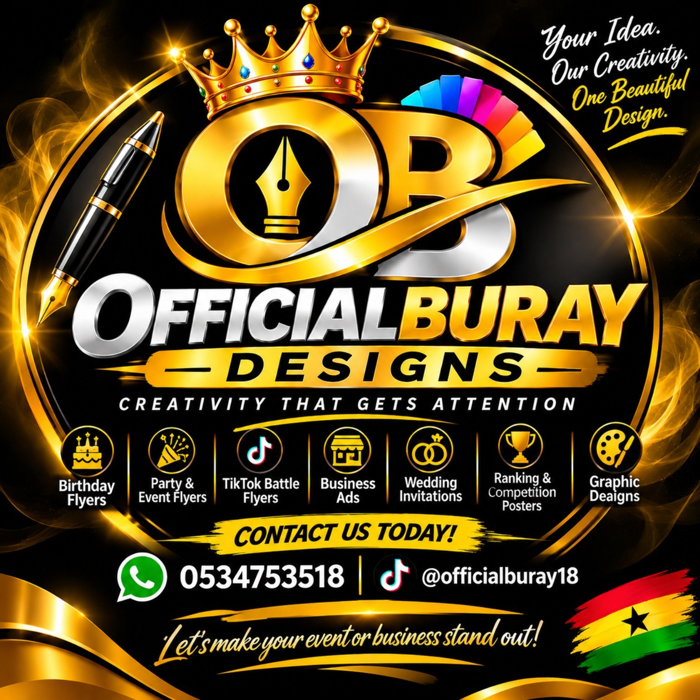

<meta name="google-site-verification" content="rvrPVAxavVVVRuQw5H1O8NDaBB77X-PDviZE8wW74pM" /># Officialburay-website
A very famous person that makes a flyer bannet and many more 
<!DOCTYPE html>
<html lang="en">
<head>
<meta charset="UTF-8">
<meta name="viewport" content="width=device-width, initial-scale=1.0">

<title>OFFICIALBURAY 👑 | Official Website</title>

<meta name="description" content="Welcome to Officialburay, Ghanaian content creator and graphic designer. Discover my work, entertainment and designs.">

<meta name="keywords" content="Officialburay, Officialburay Ghana, Officialburay Designs, Ghanaian content creator">

</head>

<body>

<header>OFFICIALBURAY 👑</header>

<nav>
<a href="#home">Home</a>
<a href="#about">About</a>
<a href="#designs">Designs</a>
<a href="#contact">Contact</a>
</nav>

<h1>WELCOME TO OFFICIALBURAY</h1>

Your destination for creativity, entertainment
and unforgettable content.

<a class="button"
href="https://www.tiktok.com/@officialburay18">
Follow on TikTok
</a>

<section id="about">
<h2>ABOUT OFFICIALBURAY</h2>

Officialburay is a Ghanaian content creator and
creative designer who enjoys entertaining people
through engaging content and funny comments.

Building a brand through creativity, originality
and consistency.

</section>

<section id="designs">
<h2>OFFICIALBURAY DESIGNS</h2>

<h3>Creative Graphic Designs</h3>

Birthday flyers, business adverts, TikTok battle
flyers, wedding invitations, event posters
and competition designs.

<a class="button"
href="https://wa.me/233534753518">
Contact for Designs
</a>
</section>

<section id="contact">
<h2>CONNECT WITH OFFICIALBURAY</h2>

Follow my journey and connect with my brand.

<a class="button"
href="https://www.tiktok.com/@officialburay18">
TikTok
</a>

<a class="button"
href="https://wa.me/233534753518">
WhatsApp
</a>
</section>

<footer>
© 2026 OFFICIALBURAY.
All Rights Reserved.
  
Ghana 🇬🇭
</footer>

</body>
</html>
